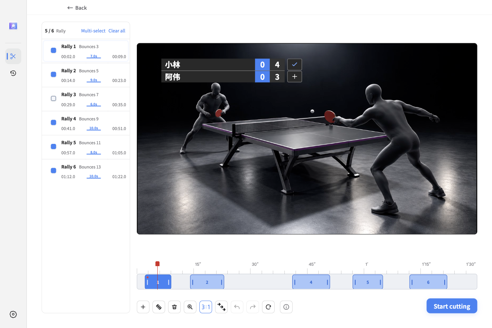
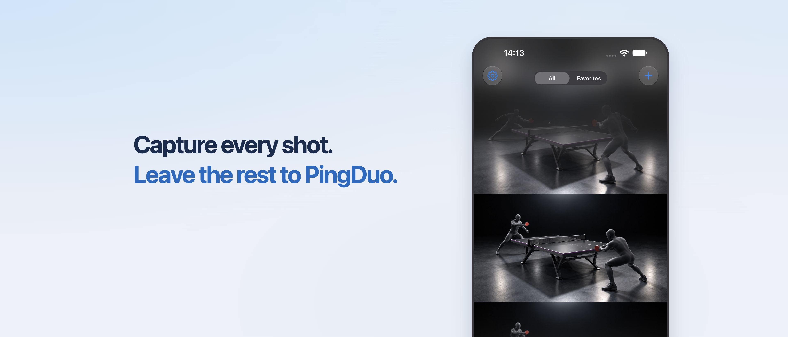
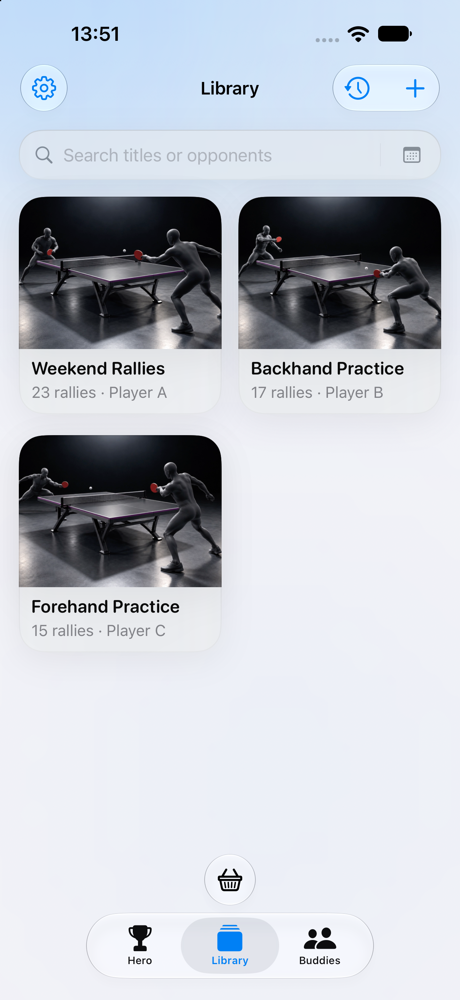
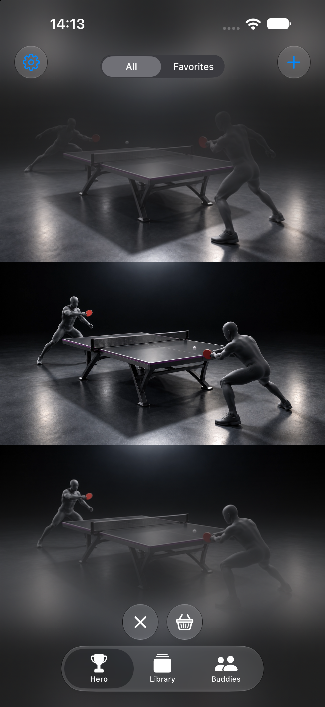
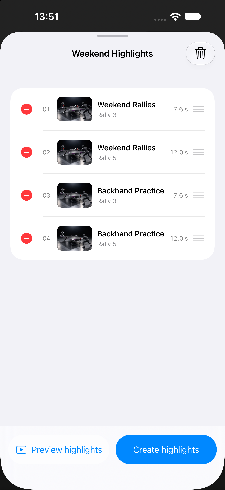

<h1 align="center">TTcut</h1>

Capture every shot. Leave the rest to TTcut.

<a href="README.md">简体中文</a> · <a href="README.zh-Hant.md">繁體中文</a> · <strong>English</strong>

  <a href="https://github.com/WeiyePlayer/TTcut/releases/latest">Download for Windows / macOS</a> ·
  <a href="https://github.com/WeiyePlayer/TTcut-Mobile-Releases/releases">Android</a> ·
  <a href="https://apps.apple.com/us/app/pingduo/id6818115664">iPhone / iPad</a>

Actual desktop app screenshot with illustrative video footage.

## From a full match to your best moments

TTcut helps table-tennis players edit their match recordings. Import a video, find the rallies, then keep them all, select highlights, or refine individual clips without repeatedly searching through a long recording.

| What you want to do | How TTcut helps |
| --- | --- |
| Organize a match quickly | Detect rallies with automatic table calibration, or adjust the four corners manually. |
| Keep the highlights | Export every rally or filter by bounce count or duration, depending on the recognition mode. |
| Refine individual clips | Preview, select, split, add and delete clips in the rally list and timeline. Adjust boundaries, undo and redo. |
| Add a scoreboard | Set player names, games and points, choose a style and position, and include the scoreboard in your export. |
| Process several matches | Add multiple videos for batch analysis and cutting, or combine their edited results into one video. |
| Share or keep editing | Export a combined video, a separate video for each rally, or an editing file you can import into Premiere. |

**Your videos stay on your computer.** The desktop app requires no account and does not upload videos. Videos and analysis history are stored locally. After installation, analysis, preview and editing work offline. Reopen an analyzed video from History to continue without analyzing it again.

## Download and install

| Device | Download | Which file to choose |
| --- | --- | --- |
| Windows x64 | [Download TTcut](https://github.com/WeiyePlayer/TTcut/releases/latest) | Choose the full installer ending in `x64-Setup.exe`. |
| macOS 15 or later · Apple Silicon | [Download for Mac](https://github.com/WeiyePlayer/TTcut/releases/latest) | The DMG is recommended: open it and drag TTcut into Applications. A ZIP is also available. Intel Macs are not supported. |
| Android | [Open the Android download page](https://github.com/WeiyePlayer/TTcut-Mobile-Releases/releases) | Download and install the APK following the release instructions. |
| iPhone / iPad | [Get PingDuo on the App Store](https://apps.apple.com/us/app/pingduo/id6818115664) | Requires iOS / iPadOS 18 or later. See the introduction below. |

The full desktop packages include everything needed to run the app. See the [latest release notes](https://github.com/WeiyePlayer/TTcut/releases/latest) for updates.

Opening TTcut on macOS for the first time

The current Mac build is not notarized, so macOS may block its first launch. After confirming that the package came from this repository, you can allow it in System Settings → Privacy & Security. Check the release notes for version-specific installation instructions.

## Make a cut in three steps

1. **Import a match.** Select or drag in an MP4 / MOV video. Use automatic calibration, or select the four table corners manually when adjustment is needed.
2. **Choose your rallies.** After analysis, select All rallies, Highlights or Custom. Custom mode lets you preview each clip, adjust its boundaries and add a scoreboard.
3. **Export your video.** Set how much footage to keep before and after rallies, then start cutting. Play the finished video or open its output folder.

For best results, use a steady camera with the entire table visible. You can correct detected rallies manually. Keep the original recording for future edits.

## iPhone and iPad: PingDuo

For editing on your phone or tablet, try **PingDuo (乒乓拍档)**. Pick a recording from Photos to organize rallies, review matches and create highlights on your device.

<table>
  <tr>
    <td></td>
    <td></td>
    <td></td>
  </tr>
</table>

- **Import and analyze:** Choose videos from Photos for on-device analysis. Ball tracking uses four-corner table calibration; action recognition needs no calibration.
- **Review rallies:** Swipe through the Hero feed, favorite good shots, exclude unwanted rallies and adjust clip boundaries.
- **Build highlights:** Collect rallies from several videos, reorder them, preview and export. You can also export all rallies or highlights from a single recording.
- **Buddies and Time Machine:** Record friends' racket setups and notes, link match videos, and revisit rallies by player or date.
- **Keep it local:** Videos, analysis results and editing records stay on your device and are not uploaded.

Each device includes **5 free successful analyses**; failed or cancelled runs do not count. Membership is available in the app for further analysis. Prices and subscription terms are shown in the App Store purchase sheet. Availability depends on your Apple ID region.

**[Get PingDuo on the App Store →](https://apps.apple.com/us/app/pingduo/id6818115664)**

## Feedback

[Report a problem or suggest a feature](https://github.com/WeiyePlayer/TTcut/issues), or contact the author on WeChat: **m2924931661**. Include your operating system, app version and steps to reproduce the issue.

## Support the project

If TTcut saves you editing time, consider supporting its continued development on Afdian. Every contribution helps keep the app improving. Thank you!

<a href="https://ifdian.net/a/weiye">Afdian · weiye</a>

