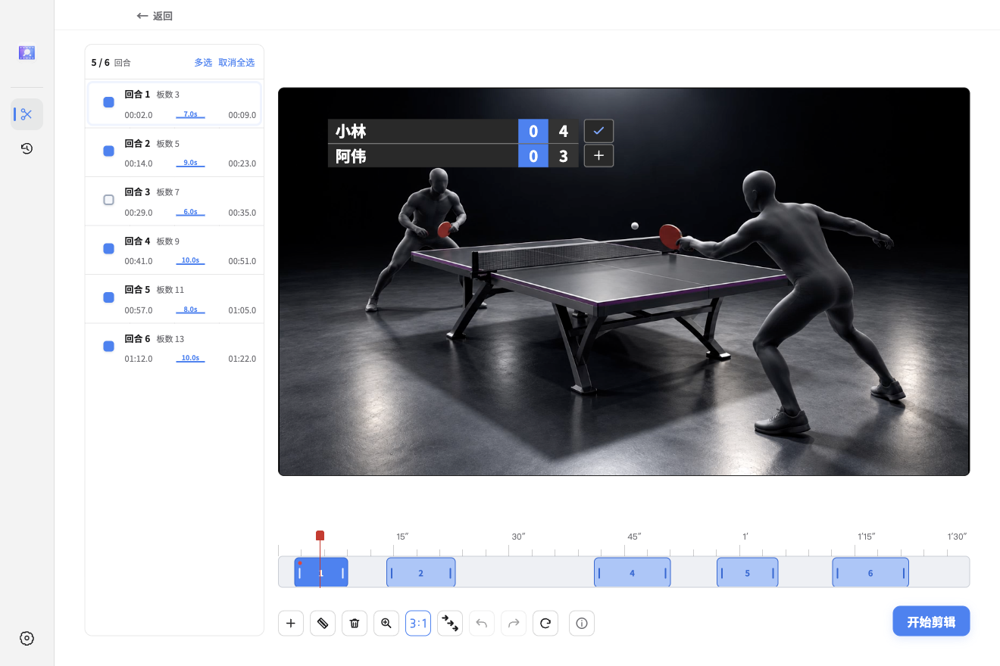
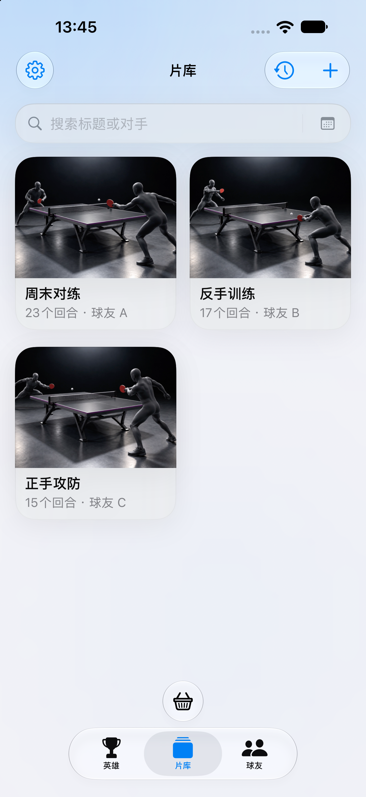
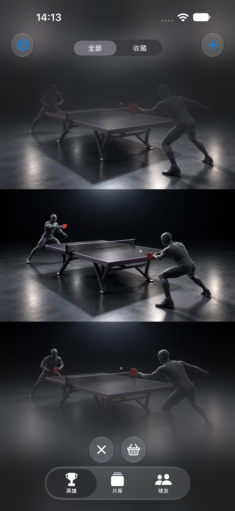
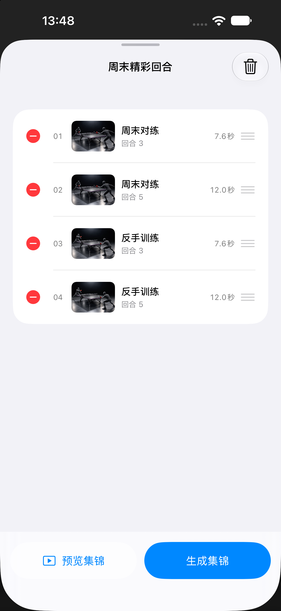

<h1 align="center">TTcut</h1>

儘管記錄每一拍，其餘交給TTcut

<a href="README.md">简体中文</a> · <strong>繁體中文</strong> · <a href="README.en.md">English</a>

  <a href="https://github.com/WeiyePlayer/TTcut/releases/latest">Windows / macOS 下載</a> ·
  <a href="https://github.com/WeiyePlayer/TTcut-Mobile-Releases/releases">Android 下載</a> ·
  <a href="https://apps.apple.com/us/app/pingduo/id6818115664">iPhone / iPad 下載</a>

桌面版真實應用程式截圖，預覽畫面使用示範素材。

## 從整場比賽，到你的精彩集錦

TTcut 是為桌球愛好者打造的影片剪輯工具。匯入比賽影片，識別有效回合，再選擇全部保留、篩選精彩或逐段精修，省去反覆拖曳長影片尋找好球的時間。

| 想做什麼 | TTcut 可以幫你 |
| --- | --- |
| 快速整理比賽 | 自動識別回合，支援自動球桌校準，也可手動調整球桌四角。 |
| 只留下精彩 | 匯出全部回合，或依板數、時長篩選精彩回合，篩選方式隨識別模式而定。 |
| 精修每個片段 | 在回合清單與時間軸中預覽、勾選、分割、新增和刪除片段，調整起訖位置，支援復原與重做。 |
| 給比賽加比分 | 設定選手姓名、局數與比分，選擇計分板樣式和位置，並隨影片一起匯出。 |
| 一次整理多場 | 批次加入影片、分析與剪輯，也可將多個影片的剪輯結果合併成片。 |
| 繼續編輯或分享 | 匯出合併影片、每回合的獨立影片，或可匯入 Premiere 的剪輯檔案。 |

**影片留在自己的電腦裡。** 桌面版無需登入，影片與分析記錄儲存在本機，不上傳影片。安裝完成後可以離線分析、預覽和剪輯；從歷史剪輯再次開啟已分析的影片，即可繼續整理，無需重複分析。

## 下載與安裝

| 裝置 | 下載入口 | 選擇哪個 |
| --- | --- | --- |
| Windows x64 | [下載桌面版](https://github.com/WeiyePlayer/TTcut/releases/latest) | 選擇檔名以 `x64-Setup.exe` 結尾的完整安裝程式。 |
| macOS 15 以上 · Apple Silicon | [下載 Mac 版](https://github.com/WeiyePlayer/TTcut/releases/latest) | 推薦 DMG，開啟後將 TTcut 拖入「應用程式」；另提供 ZIP。不支援 Intel Mac。 |
| Android | [前往 Android 下載頁面](https://github.com/WeiyePlayer/TTcut-Mobile-Releases/releases) | 依發布頁說明下載並安裝 APK。 |
| iPhone / iPad | [在 App Store 取得乒乓拍檔](https://apps.apple.com/us/app/pingduo/id6818115664) | iOS / iPadOS 18 以上，功能介紹見下方。 |

桌面完整安裝包已包含執行所需資源，安裝後即可使用。版本更新內容請查看[發布說明](https://github.com/WeiyePlayer/TTcut/releases/latest)。

macOS 首次開啟提示

目前 Mac 版尚未公證，首次開啟可能被系統攔截。確認安裝包來自本儲存庫後，可在「系統設定 → 隱私權與安全性」中允許開啟。具體安裝提示以對應版本的發布說明為準。

## 三步完成一段剪輯

1. **匯入比賽。** 選擇或拖入 MP4 / MOV 影片，使用自動校準；需要修正時，手動點選球桌四角。
2. **選擇回合。** 分析完成後，選擇所有回合、精彩回合或自訂。自訂模式可逐段預覽並調整邊界，也可加入計分板。
3. **匯出成片。** 設定回合前後的保留時間，開始剪輯。完成後直接播放，或開啟輸出資料夾。

建議使用機位穩定、球桌完整可見的影片。自動識別結果可以手動修正；請保留原始影片，方便日後繼續編輯。

## iPhone 與 iPad：乒乓拍檔

想在手機或平板上整理比賽，推薦使用 **乒乓拍檔（PingDuo，商店名稱「乒乓拍档」）**。從照片中選擇影片，即可在裝置上整理回合、重看比賽、製作集錦。

<table>
  <tr>
    <td></td>
    <td></td>
    <td></td>
  </tr>
</table>

- **匯入與識別：** 從照片選擇比賽影片，在裝置上分析；球追蹤可校準球桌四角，動作識別無需校準。
- **回合重看：** 在「英雄」中上下滑動瀏覽，收藏好球、排除不需要的回合，調整片段起訖位置。
- **集錦剪輯：** 將多個影片裡的回合加入集錦、調整順序、預覽並匯出，也可一鍵匯出單個影片的全部或精彩回合。
- **球友與時光機：** 記錄球友的球拍配置和便箋，關聯比賽影片，依球友或日期重溫比賽。
- **本地儲存：** 影片、識別結果和編輯記錄儲存在裝置上，不上傳這些資料。

每台裝置可完成 **5 次免費分析**，失敗或取消不扣次數；需要更多分析時，可在應用程式內了解會員。價格與訂閱資訊以 App Store 購買頁面為準；下載可用性以 Apple ID 所在地區為準。

**[在 App Store 取得乒乓拍檔 →](https://apps.apple.com/us/app/pingduo/id6818115664)**

## 交流與回饋

遇到問題或有新功能建議，歡迎[提交回饋](https://github.com/WeiyePlayer/TTcut/issues)，也可以加入作者微信：**m2924931661**。回報時附上系統、應用程式版本和操作步驟，有助於更快找出問題。

## 打賞支持

如果 TTcut 幫你省下了剪輯時間，歡迎透過愛發電支持作者，讓這個小工具持續改進。每一份支持，都是繼續維護和改進的動力。謝謝！

<a href="https://ifdian.net/a/weiye">愛發電 · weiye</a>

